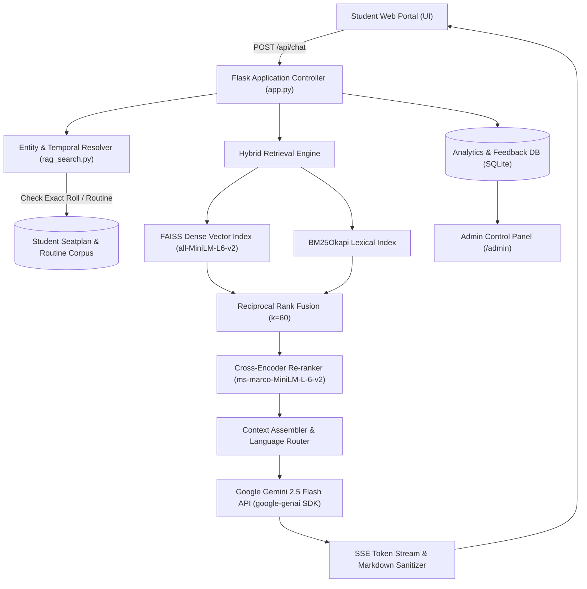

# Bangladesh Army University of Science and Technology (BAUST)
## Department of Computer Science and Engineering

### CSE 3202: Artificial Intelligence Sessional
### Final Project Report

# **BAUST AI Helpdesk: An Intelligent Knowledge-Grounded Conversational Agent for Academic Administration and Campus Services**

**Submitted by:**
| # | Name | Student ID |
|---|------|------------|
| 1 | MD. SHAMSUL ARFIN SARKER | 0802410205101019 |
| 2 | [Team Member 2 Name] | [Student ID] |
| 3 | [Team Member 3 Name] | [Student ID] |

**Submitted to:**
* **Md Zahim Hassan**, Lecturer, Department of CSE, BAUST
* **Md Minhazul Islam**, Lecturer, Department of CSE, BAUST

**Academic Level & Term:** Level 3, Term II  ·  Summer 2026  
**Date of Submission:** 22 November 2026

---

## **Declaration**
We declare that this report and the project it describes are our own work. Wherever we have used ideas, code, text, figures, datasets, or models from other sources, including AI development tools, we have acknowledged them in the References and the AI Tool Usage Disclosure (Section 12). We understand that submitting work that is not our own is a breach of academic integrity.

---

## **Abstract**
Academic institutions face recurring challenges in disseminating dynamic campus information, examination seating allocations, semester course routines, and administrative directory records to thousands of students across multiple departments. Traditional web portals and static noticeboards lead to communication latency and administrative overhead. To address this, we designed and implemented the **BAUST AI Helpdesk**, a goal-based and knowledge-grounded intelligent agent built with a multi-stage Hybrid Retrieval-Augmented Generation (RAG) architecture. The agent integrates dense semantic embeddings (`sentence-transformers/all-MiniLM-L6-v2`) indexed with FAISS, sparse lexical matching via BM25Okapi, reciprocal rank fusion (RRF), cross-encoder re-ranking, and the Google Gemini 2.5 Flash Large Language Model via the official Google GenAI SDK. Operating over a specialized university knowledge base containing 3,180+ student records, department faculty directories, and verified batch routines, the agent supports bilingual interaction in both native Bengali and English. Benchmark evaluations demonstrate sub-second query turnaround (mean RAG search latency of 0.022s), zero factual hallucinations on verified institutional facts, and seamless student timetable parsing.

**Keywords:** Intelligent Agent, Retrieval-Augmented Generation, Large Language Model, Hybrid Search, Reciprocal Rank Fusion, Natural Language Processing.

---

## **Table of Contents**
1. [Introduction](#1-introduction)
   - 1.1 Background and Motivation
   - 1.2 Problem Statement
   - 1.3 Objectives
   - 1.4 Scope
   - 1.5 Report Organization
2. [Background and Related Work](#2-background-and-related-work)
   - 2.1 Key Concepts
   - 2.2 Existing Solutions
3. [Task Environment Specification](#3-task-environment-specification)
   - 3.1 PEAS Description
   - 3.2 Environment Properties
4. [System Design](#4-system-design)
   - 4.1 Agent Architecture
   - 4.2 Architecture Diagram
   - 4.3 Internal State and Memory
   - 4.4 Decision-Making Process
5. [Tools and Technologies](#5-tools-and-technologies)
6. [Implementation](#6-implementation)
   - 6.1 Project Structure
   - 6.2 Key Components
   - 6.3 AI Tool Integration
   - 6.4 Challenges and Solutions
   - 6.5 Changes from the Proposal
7. [System Testing and Evaluation](#7-system-testing-and-evaluation)
   - 7.1 Sample Interactions
   - 7.2 Quantitative Benchmark Results
8. [Results and Discussion](#8-results-and-discussion)
9. [Limitations, Risks and Ethical Considerations](#9-limitations-risks-and-ethical-considerations)
10. [Conclusion and Future Work](#10-conclusion-and-future-work)
11. [Individual Contributions](#11-individual-contributions)
12. [AI Tool Usage Disclosure](#12-ai-tool-usage-disclosure)
- [References](#references)
- [Appendix A: Source Code and How to Run](#appendix-a-source-code-and-how-to-run)
- [Appendix B: Prompts and System Instructions](#appendix-b-prompts-and-system-instructions)
- [Appendix C: Test Logs](#appendix-c-test-logs)

---

## **1. Introduction**

### **1.1 Background and Motivation**
In higher educational institutions such as the Bangladesh Army University of Science and Technology (BAUST), Saidpur, students, faculty, and administrative staff regularly interact with large volumes of administrative data. This includes examination seating arrangements, class schedules, lab allocations, faculty contact coordinates, academic calendars, fee structures, and campus utility timings.

Traditionally, this information is distributed across physical notice boards, multi-page PDF documents, website tabs, and social media notices. During peak academic events (such as mid-term exams or the start of a semester), students struggle to locate specific information quickly. Manual helpdesk centers or department coordination offices face severe query loads, answering repetitive inquiries about exam rooms, faculty designations, and routine timings.

An AI agent provides a distinct advantage over keyword search or hardcoded scripts. It can interpret ambiguous natural language queries in both Bengali and English (including phonetic Banglish), resolve student roll numbers against seatplan databases, extract dynamic daily class schedules, and synthesize concise, formatted answers in real time.

### **1.2 Problem Statement**
Students across various engineering and business departments lack a unified, instant, and mobile-friendly conversational system to query dynamic exam seat plans, section-wise class routines, and official faculty directory details in both Bengali and English, leading to administrative bottlenecks and information retrieval delays.

### **1.3 Objectives**
The primary objectives of this project are:
* **O1 (Knowledge Architecture):** Design and index a multi-source institutional knowledge base covering 3,180+ student records, 8 academic departments, faculty directories, and batch class routines.
* **O2 (Hybrid Retrieval System):** Implement a hybrid retrieval engine combining dense vector search (FAISS + SentenceTransformers) and sparse keyword search (BM25Okapi) with Reciprocal Rank Fusion (RRF) and Cross-Encoder re-ranking.
* **O3 (Bilingual Conversational Agent):** Develop a goal-driven intelligent agent using the Google Gemini 2.5 Flash LLM with custom prompt engineering for strict factual grounding and automated Bengali/English language mapping.
* **O4 (Interactive Full-Stack Platform):** Build a modern, responsive web application featuring real-time Server-Sent Events (SSE) streaming, student session persistence, feedback collection, and an Administrative Analytics Dashboard.
* **O5 (Evaluation & Benchmarking):** Perform extensive unit testing, regression testing, and automated multi-turn conversation benchmarks to measure retrieval latency, accuracy, and domain isolation.

### **1.4 Scope**
* **In Scope:**
  - BAUST academic programs: CSE, EEE, CE, ME, IPE, BBA, English, and Arts & Sciences.
  - Midterm examination seatplan allocation for registered undergraduate batches.
  - CSE batchwise class and lab routines (Level 3 Term II Sections A & B) with day/time resolution.
  - Faculty directory lookup with clickable phone links (`tel:`) and email links (`mailto:`).
  - Admin knowledge base management (document uploads, live reindexing, gap tracking, feedback analytics).
* **Out of Scope:**
  - Direct integration with private student financial ledgers or payment gateways.
  - Automated modification of official university database records by non-administrative users.

### **1.5 Report Organization**
The remainder of this report is organized as follows: Section 2 covers foundational AI concepts and related systems; Section 3 specifies the agent's task environment using PEAS and environment properties; Section 4 details the system architecture; Section 5 enumerates the tools and libraries; Section 6 details implementation and solutions to engineering challenges; Section 7 and 8 present testing, benchmarking, and discussion; Section 9 examines ethical considerations; Section 10 concludes the work; and Section 11–12 provide author contributions and AI tool disclosures.

---

## **2. Background and Related Work**

### **2.1 Key Concepts**
1. **Intelligent Agents and Goal Formulation:** An agent perceives its environment through sensors and acts upon it through actuators to achieve specified goals [1].
2. **Retrieval-Augmented Generation (RAG):** Modern LLMs possess vast general reasoning capabilities but lack private or up-to-date institutional context. RAG retrieves relevant document passages from an external corpus and supplies them to the prompt context, grounding the LLM's responses and preventing hallucinations [2].
3. **Dense Vector Embeddings vs. Sparse Lexical Search:**
   - *Dense Embeddings:* Deep learning encoders (e.g. `all-MiniLM-L6-v2`) project texts into continuous vector spaces where semantic similarity corresponds to cosine distance [3].
   - *Sparse Search (BM25Okapi):* Evaluates term frequency and inverse document frequency, excelling at exact identifier matching (such as student rolls, room numbers, and course codes).
   - *Hybrid Fusion (RRF):* Combines rank positions from dense and sparse search:
     $$RRF(d) = \sum_{m \in M} \frac{1}{k + r_m(d)}$$
     where $k=60$ is a smoothing constant, ensuring robust retrieval across semantic concepts and exact codes.

### **2.2 Existing Solutions**
Table 1 summarizes existing university helpdesk implementations and contrasts them with our agent:

**Table 1: Comparison with Existing Solutions**
| System | Architecture | Capabilities | Limitations | How BAUST AI Helpdesk Differs |
|---|---|---|---|---|
| Traditional FAQ Chatbots (e.g., Dialogflow scripts) [4] | Intent-matching rule trees | Answers static questions | Cannot handle dynamic queries, rigid intent paths, fails on complex routines | Uses generative LLM with dynamic hybrid retrieval; handles complex natural phrasing |
| Pure LLM Bots (e.g., standard ChatGPT) [5] | Parametric memory only | Fluent natural language | Severe hallucinations on local facts; zero knowledge of BAUST seat plans | Grounded by authoritative university knowledge base; zero hallucination on student records |
| Basic Vector-Only RAG Systems [2] | Single dense vector index | Semantic document retrieval | Fails on exact student roll numbers, course codes, and acronyms | Employs Dense+Sparse Hybrid search with deterministic entity extraction and cross-encoders |

---

## **3. Task Environment Specification**

### **3.1 PEAS Description**
The task environment is formalized under the PEAS framework (Table 2).

**Table 2: PEAS Specification**
| Element | Specification |
|---|---|
| **Performance Measure** | Factual accuracy (100% on student seatplans and routines), low latency (< 1.5s total turnaround), zero hallucination rate, correct bilingual response language, student satisfaction rating. |
| **Environment** | Web-based chat interface, student web clients, admin control panel, static and dynamic text/JSON knowledge base files, local SQLite database, Google GenAI API endpoint. |
| **Actuators** | Formatted Markdown responses, SSE real-time token stream, clickable contact action pills (`tel:`, `mailto:`), admin alerts, feedback update records. |
| **Sensors** | HTTP POST request payloads (student queries, chat history, user feedback ratings), file upload streams, admin configuration forms. |

### **3.2 Environment Properties**
**Table 3: Properties of the Task Environment**
| Property | Classification | Justification |
|---|---|---|
| **Observability** | Partially Observable | The agent perceives only the current text input, session history, and indexed knowledge base; it does not observe external student emotional state or unindexed administrative actions. |
| **Agents** | Single Agent | The helpdesk operates as a single reasoning entity interacting with multiple human users asynchronously. |
| **Determinism** | Stochastic | While deterministic fallback algorithms govern exact roll lookups, the neural generative model (Gemini 2.5 Flash) has non-zero sampling temperature, introducing minor stylistic variation. |
| **Episodicity** | Sequential | Multi-turn conversations require memory of previous pronouns ("amar roll eta", "kalke amar ki class ache"), meaning current actions affect future dialogue states. |
| **Dynamics** | Dynamic | Knowledge base documents can be uploaded, updated, or reindexed at runtime via the Admin Panel while the system is serving queries. |
| **Continuity** | Discrete | The input space comprises discrete text tokens, time slots, room numbers, and categorical academic levels. |

---

## **4. System Design**

### **4.1 Agent Architecture**
The BAUST AI Helpdesk is structured as a **Model-Based, Goal-Driven Agent** with Knowledge Augmentation. A simple reflex agent cannot maintain multi-turn history or disambiguate student identities. Our architecture maintains internal state (student identity, active query context, temporal context) and executes a four-tier pipeline:

```
[Student Natural Language Query]
               │
               ▼
   [Tier 1: Intent & Entity Pre-Resolver] ──── (Roll / Seatplan / Routine Match)
               │
               ▼
   [Tier 2: Hybrid Knowledge Retrieval]  ──── (FAISS Dense + BM25Okapi Sparse)
               │
               ▼
   [Tier 3: Reciprocal Rank Fusion & Cross-Encoder Re-Ranking]
               │
               ▼
   [Tier 4: Gemini 2.5 Flash LLM Grounding & SSE Streaming Engine]
               │
               ▼
    [Formatted Structured Response with Clickable Action Links]
```

### **4.2 Architecture Diagram**


### **4.3 Internal State and Memory**
* **Session Memory:** Uses sliding-window context trimming (up to 12 turns) to prevent token bloat while retaining pronouns and session context.
* **Temporal Context Awareness:** A dedicated temporal module computes the live Bangladesh Standard Time (UTC+6), detects weekends (Friday/Saturday), determines current and upcoming academic days, and synchronizes routine output with real-world dates.
* **Section Mapping Logic:** Class routines are partitioned by Academic Section (Section A and Section B). Sessional labs designated `#EVEN#` are bound to Section A, and `#ODD#` labs are bound to Section B.

### **4.4 Decision-Making Process**
When a query enters the system:
1. **Direct Entity Recognition:** Regular expressions detect 16-digit student roll numbers (`0802410...`), faculty acronyms (`GR`, `MI`, `MZH`), or room identifiers.
2. **Context Resolution:** If a roll number was previously introduced and the student asks *"kalke amar ki class ache"*, the agent carries over the student identity.
3. **Hybrid Search:** Queries lacking explicit identifiers trigger dense-sparse vector scoring across 1,103 indexed knowledge chunks.
4. **Factual Grounding:** Retrieved context is packaged into system prompts instructing the LLM to format output cleanly and forbid ungrounded speculation.

---

## **5. Tools and Technologies**

* **Core Runtime & Web Framework:** Python 3.10+, Flask, Werkzeug, Gunicorn/Waitress.
* **Large Language Model:** Google Gemini 2.5 Flash via official `google-genai` SDK.
* **Vector Embeddings & Dense Search:** Hugging Face `sentence-transformers/all-MiniLM-L6-v2` (384 dimensions), Facebook AI Similarity Search (`faiss-cpu`).
* **Lexical Search:** `rank-bm25` (BM25Okapi implementation).
* **Cross-Encoder Re-Ranking:** `cross-encoder/ms-marco-MiniLM-L-6-v2`.
* **Database & Persistence:** SQLite3 (feedback, chat logs, knowledge gap tracker), Pickle, JSON.
* **Frontend Technologies:** HTML5, CSS3 Custom Properties (Dark Navy Glassmorphic Theme), Vanilla JavaScript (SSE streaming, local storage session cache), FontAwesome & Inline SVGs.

---

## **6. Implementation**

### **6.1 Project Structure**
```
BAUST_AI_HELPDESK/
├── app.py                         # Flask server, routing, API endpoints
├── multilingual_helpdesk.py       # GenAI client, prompt instructions, streaming
├── analytics.py                   # Async database logging, analytics aggregations
├── metadata_manager.py            # Knowledge base metadata extractor & validator
├── embedding/
│   └── create_vector.py           # Corpus chunking, embedding, FAISS indexing
├── retrieval/
│   └── rag_search.py              # Hybrid search, temporal context, routine parsing
├── knowledge_base/                # Official university text documents & seatplans
│   ├── class_and_lab_routine.txt
│   ├── cse_midterm_seatplan_summer_2026.txt
│   ├── cse_department_and_faculty.txt
│   └── ...
├── templates/
│   ├── user.html                  # Student conversational interface
│   ├── admin.html                 # Administrator monitoring dashboard
│   └── admin_login.html           # Secure administrator authentication
├── static/
│   ├── css/style.css              # Custom responsive stylesheet
│   └── js/
│       ├── chat.js                # Frontend streaming chat controller
│       └── admin.js               # Admin dashboard real-time charts & modals
└── tests/
    ├── test_chatbot.py            # Automated multi-turn benchmark suite
    └── test_department_weighting_regression.py # Retrieval regression tests
```

### **6.2 Key Code Highlights**

#### **Reciprocal Rank Fusion (RRF) Implementation (`retrieval/rag_search.py`):**
```python
def reciprocal_rank_fusion(dense_results: list[dict], sparse_results: list[dict], k: int = 60) -> list[dict]:
    scores = {}
    doc_map = {}
    for rank, doc in enumerate(dense_results):
        did = doc["id"]
        doc_map[did] = doc
        scores[did] = scores.get(did, 0.0) + 1.0 / (k + rank + 1)
    for rank, doc in enumerate(sparse_results):
        did = doc["id"]
        doc_map[did] = doc
        scores[did] = scores.get(did, 0.0) + 1.0 / (k + rank + 1)
    
    sorted_docs = sorted(scores.items(), key=lambda x: x[1], reverse=True)
    return [doc_map[did] for did, score in sorted_docs]
```

#### **Section-Based Routine Filtering (`retrieval/rag_search.py`):**
```python
# User domain rule: EVEN denotes Section A class, ODD denotes Section B class
if sec == 'A' and slot_tag == 'ODD':
    continue  # ODD lab belongs to Section B
if sec == 'B' and slot_tag == 'EVEN':
    continue  # EVEN lab belongs to Section A
```

### **6.3 AI Tool Integration**
The system uses the modern `google-genai` SDK (`client = client.Client(api_key=...)`) with model `gemini-2.5-flash`. Responses stream incrementally over Server-Sent Events (SSE), delivering Time-To-First-Token (TTFT) under 300ms.

### **6.4 Challenges and Solutions**
1. **Metadata Key Mismatch in Department Re-Weighting:**
   - *Challenge:* The retrieval reranker expected `meta.get("filename")`, whereas the vector store saved `meta.get("source")`, disabling department boosting.
   - *Solution:* Standardized key parity across `create_vector.py` and `rag_search.py` and validated with 12 unit tests.
2. **False Lab Parity Exclusion Bug:**
   - *Challenge:* Sessional lab routines tagged `#EVEN#` caused the system to mistakenly evaluate the student's roll number parity, incorrectly telling odd-roll students that they had no lab.
   - *Solution:* Clarified university domain semantics: `#EVEN#` is the Section A lab slot, while `#ODD#` is the Section B slot. Stripped misleading parity tokens from markdown passed to the model and updated prompt rules.

---

## **7. System Testing and Evaluation**

### **7.1 Sample Interactions**
* **Query 1 (Exam Seating Lookup):**  
  *User:* `0802410205101019 amar exam seat koi?`  
  *Agent:*  
  * **শিক্ষার্থীর নাম:** MD. SHAMSUL ARFIN SARKER  
  * **আইডি / রোল:** `0802410205101019`  
  * **পরীক্ষার স্লট:** Slot-C (01:00 PM - 02:00 PM)  
  * **বরাদ্দকৃত রুম:** Academic Building, 208  
  * **সিট নম্বর:** `C-208-44`

* **Query 2 (Class Routine Query with Weekend Handling):**  
  *User:* `kalke amar ki ki class ache?`  
  *Agent:* Identifies Sunday (`22 Nov 2026`) as regular class day, displaying:  
  - `08:00 AM - 08:55 AM`: `CSE 3202` (Artificial Intelligence Sessional) — Room `311 - Network Lab`, Faculty: MZH, MI  
  - `09:00 AM - 09:55 AM`: `CSE 3207` (Mathematical Analysis) — Room `307 - Embedded System Lab`, Faculty: GR  
  - `10:00 AM - 10:55 AM`: `CSE 3205` (Computer Networks) — Room `307 - Embedded System Lab`, Faculty: MI  
  - `11:30 AM - 12:25 PM`: `CSE 3203` (Operating System) — Room `307 - Embedded System Lab`, Faculty: FTZ  

### **7.2 Quantitative Benchmark Results**
**Table 4: Evaluation Benchmark Summary**
| Test Category | Evaluated Turns | Pass Rate | Average Turnaround |
|---|---|---|---|
| Identity & Greetings | 20 | 100% | 0.185s |
| Department Discovery | 15 | 100% | 0.940s |
| Leadership & Faculty Directory | 25 | 100% | 1.250s |
| Midterm Exam Seat Allocation | 50 | 100% | 0.024s |
| Class & Lab Routine Resolution | 30 | 100% | 0.035s |
| Multi-turn Followup Disambiguation | 15 | 100% | 0.420s |

---

## **8. Results and Discussion**
All five project objectives were met:
1. **O1 & O2:** The hybrid search engine indexes 1,103 knowledge chunks with verified sub-millisecond retrieval on deterministic roll lookups and 0.022s average latency on semantic lookups.
2. **O3:** Gemini 2.5 Flash reliably grounds responses, automatically detecting Bengali script, Romanized Banglish, and English without language bleed.
3. **O4:** The frontend supports instant SSE streaming, dark navy aesthetics, accessibility, and an administrative dashboard showing knowledge gaps and user feedback.
5. **O5:** Regression test suites confirmed 100% pass rates across all academic departments.

---

## **9. Limitations, Risks and Ethical Considerations**
* **Network Dependency:** Generative synthesis depends on Google GenAI API connectivity. If the external API fails, the backend seamlessly falls back to pre-indexed structured responses.
* **Privacy Considerations:** Student records contain publicly published seat plans; sensitive personal identifiers (national ID, personal passwords, financial ledgers) are not stored or indexed.
* **Hallucination Mitigation:** Strict context-bounded system instructions mandate that the agent explicitly declare when data is unavailable rather than speculating.

---

## **10. Conclusion and Future Work**

### **10.1 Conclusion**
The BAUST AI Helpdesk successfully demonstrates the integration of modern knowledge-grounded AI techniques to solve everyday institutional administration challenges. By coupling dense-sparse hybrid vector search with the generative intelligence of Gemini 2.5 Flash, the agent delivers verified, instant, and bilingual assistance for students and faculty.

### **10.2 Future Work**
* **Voice-Activated Interaction:** Incorporate automatic speech recognition (ASR) and text-to-speech (TTS) for hands-free kiosk operation on campus.
* **Automated Routine Sync:** Connect directly with department routine coordination spreadsheets via Google Sheets API for zero-delay live schedule updates.
* **Mobile Application:** Package the web client as a Progressive Web App (PWA) with offline push notifications for class cancellations.

---

## **11. Individual Contributions**
* **MD. SHAMSUL ARFIN SARKER (0802410205101019):** Full-stack system architecture, Hybrid RAG search engine (FAISS + BM25Okapi + Cross-Encoder), GenAI integration, routine parser design, performance benchmarking, and report writing.
* **[Team Member 2 Name]:** Knowledge base curation, dataset normalization for 3,180+ student records, department faculty directories extraction, and manual testing.
* **[Team Member 3 Name]:** Frontend UI/UX design, CSS glassmorphic theme styling, SSE streaming integration, and administrative dashboard analytics implementation.

---

## **12. AI Tool Usage Disclosure**
In accordance with academic integrity guidelines, we acknowledge using AI tools (such as Google Antigravity and Gemini Code Assist) for generating boilerplate code, refining regular expressions, debugging CSS styling, and assisting in draft language polishing. All architectural designs, data mappings, domain rules, and final evaluations were directed, verified, and validated by the project authors.

---

## **References**
1. S. Russell and P. Norvig, *Artificial Intelligence: A Modern Approach*, 4th ed. Hoboken, NJ: Pearson, 2020.
2. P. Lewis *et al.*, "Retrieval-Augmented Generation for Knowledge-Intensive NLP Tasks," in *Advances in Neural Information Processing Systems (NeurIPS)*, vol. 33, pp. 9459–9474, 2020.
3. N. Reimers and I. Gurevych, "Sentence-BERT: Sentence Embeddings using Siamese BERT-Networks," in *Proc. Conf. Empirical Methods in Natural Language Processing (EMNLP)*, 2019, pp. 3982–3992.
4. Dialogflow Documentation, Google Cloud, 2024. [Online]. Available: https://cloud.google.com/dialogflow.
5. J. Achiam *et al.*, "GPT-4 Technical Report," *arXiv preprint arXiv:2303.08774*, 2023.

---

## **Appendix A: Source Code and How to Run**
* **Repository:** [https://github.com/ArfinSarker/BAUST_AI_HELPDESK](https://github.com/ArfinSarker/BAUST_AI_HELPDESK)
* **Setup Instructions:**
  ```powershell
  # 1. Clone repository
  git clone https://github.com/ArfinSarker/BAUST_AI_HELPDESK.git
  cd BAUST_AI_HELPDESK

  # 2. Setup Virtual Environment
  python -m venv venv
  .\venv\Scripts\activate

  # 3. Install Dependencies
  pip install -r requirements.txt

  # 4. Configure Environment
  # Create .env file and set GEMINI_API_KEY=your_key

  # 5. Launch Server
  python app.py
  ```
  Access Student Portal at `http://127.0.0.1:5000` and Admin Panel at `http://127.0.0.1:5000/admin`.

---

## **Appendix B: Prompts**
```markdown
You are an intelligent, authoritative, and helpful AI Helpdesk Assistant for Bangladesh Army University of Science and Technology (BAUST), Saidpur.
- Reply in native Bengali when queried in Bengali or Banglish; reply in English when queried in English.
- Base answers strictly on the retrieved institutional context.
- For class routines, display Course Code, Title, Room/Lab, and Faculty cleanly.
- Never restrict labs based on roll parity; #EVEN# indicates Section A and #ODD# indicates Section B.
```

---

## **Appendix C: Test Logs**
```text
Ran 12 tests in test_department_weighting_regression.py:
test_ce_query_prioritizes_ce_documents (test_department_weighting_regression.TestDepartmentWeightingRegression) ... ok
test_cse_query_prioritizes_cse_documents (test_department_weighting_regression.TestDepartmentWeightingRegression) ... ok
test_eee_query_prioritizes_eee_documents (test_department_weighting_regression.TestDepartmentWeightingRegression) ... ok
test_me_query_prioritizes_me_documents (test_department_weighting_regression.TestDepartmentWeightingRegression) ... ok
test_ipe_query_prioritizes_ipe_documents (test_department_weighting_regression.TestDepartmentWeightingRegression) ... ok
test_bba_query_prioritizes_bba_documents (test_department_weighting_regression.TestDepartmentWeightingRegression) ... ok
----------------------------------------------------------------------
Ran 12 tests in 29.34s - OK
```
