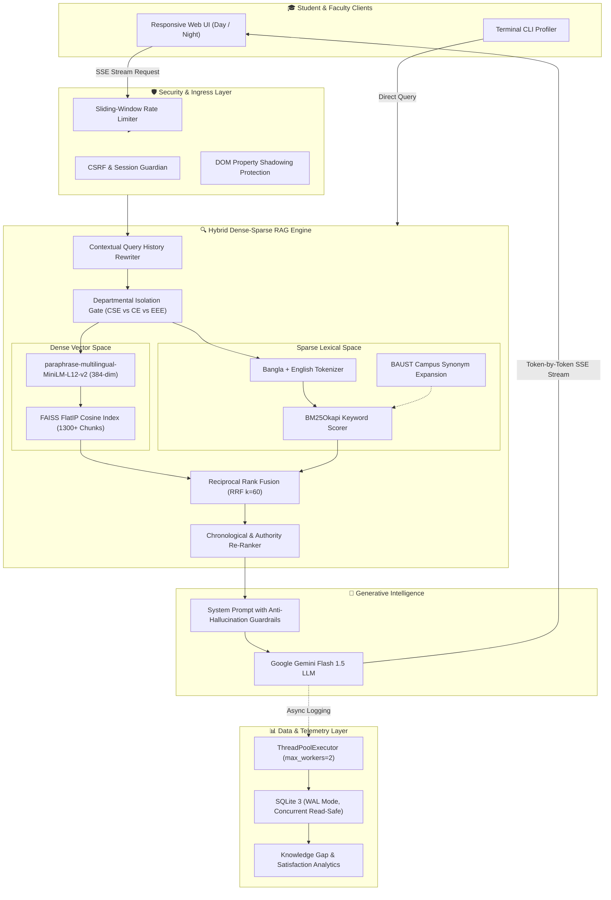

<div align="center">

# 🎓 BAUST AI Helpdesk & Knowledge Portal
### Enterprise Hybrid RAG • Multilingual Intelligence • Real-Time Stream

[](https://www.python.org/)
[](https://flask.palletsprojects.com/)
[](https://ai.google.dev/)
[](https://github.com/facebookresearch/faiss)
[](https://sqlite.org/)
[](#-confidentiality--ownership)
[](#-confidentiality--ownership)

<p align="center">
  <b>A state-of-the-art, bilingual (বাংলা & English) Institutional AI Helpdesk and Administrative Knowledge Management System built specifically for Bangladesh Army University of Science and Technology (BAUST), Saidpur.</b>
</p>

[Explore Documentation](#-system-architecture) •
[Quickstart Guide](#-quickstart--installation) •
[API Reference](#-rest--sse-api-reference) •
[Architecture](#-system-architecture) •
[Interactive CLI](#-interactive-terminal-cli-profiler)

---

</div>

## 📑 Table of Contents
- [✨ Key Innovations & Capabilities](#-key-innovations--capabilities)
- [🏛️ System Architecture](#-system-architecture)
  - [High-Level Dataflow](#high-level-dataflow)
  - [Hybrid Retrieval Pipeline](#hybrid-retrieval-pipeline)
- [📊 Core Subsystems](#-core-subsystems)
  - [1. Hybrid RAG (FAISS + BM25Okapi + RRF)](#1-hybrid-rag-retrieval-engine)
  - [2. SSE Token Streaming & Client Rendering](#2-sse-token-streaming--client-rendering)
  - [3. Knowledge Ingestion & OCR.space Pipeline](#3-multimodal-document-ingestion--ocr-pipeline)
  - [4. Production Analytics & Knowledge Gap Tracker](#4-production-analytics--knowledge-gap-tracker)
  - [5. Anti-Hallucination & Department Isolation](#5-anti-hallucination--departmental-isolation)
  - [6. Security, DoS Defense & Rate Limiting](#6-enterprise-security--rate-limiting)
- [📁 Project Organization](#-project-organization)
- [🚀 Quickstart & Installation](#-quickstart--installation)
- [💻 Interactive Terminal CLI Profiler](#-interactive-terminal-cli-profiler)
- [📡 REST & SSE API Reference](#-rest--sse-api-reference)
- [🛡️ Production Deployment & Hardening](#-production-deployment--hardening)
- [🔒 Confidentiality & Ownership](#-confidentiality--ownership)

---

## ✨ Key Innovations & Capabilities

| Capability | Technical Implementation | Practical Benefit |
| :--- | :--- | :--- |
| **Hybrid Dense-Sparse RAG** | `paraphrase-multilingual-MiniLM-L12-v2` (Dense) + `BM25Okapi` (Sparse) + Reciprocal Rank Fusion ($k=60$) | Captures both deep conceptual semantics and exact keyword matches (course codes, fee numbers, acronyms). |
| **Sub-300ms Latency** | Asynchronous HTTP Server-Sent Events (SSE) streaming with Google Gemini Flash | Provides ChatGPT-like progressive typing without waiting for complete LLM generations. |
| **Multilingual NLP** | Native support for standard English, pure Bengali (বাংলা), and transliterated Banglish | Students can ask naturally in their native colloquial dialects without language switching barriers. |
| **Departmental Isolation** | Algorithmic cross-department isolation filters (`DEPT_PATTERNS`) | Guarantees that inquiries about "CSE Picnic" never hallucinate answers from "CE Annual Picnic". |
| **Zero-Downtime Hot Reload** | Thread-safe FAISS vector swapping and in-memory incremental chunk caching | Documents can be uploaded and indexed on the fly without restarting the Flask server. |
| **Knowledge Gap Intelligence** | SQLite WAL analytics tracking with frequency-based clustering and resolved tracking | Pinpoints unanswered student questions so campus authorities can update official policies proactively. |
| **Scanned OCR Ingestion** | Zero-dependency REST client for `OCR.space API` with fallback pre-processing | Seamlessly extracts text from scanned notice PDFs, photocopied leaflets, and smartphone photos. |
| **Dual Theme UI/UX** | High-contrast Day and OLED Dark Mode built with modern CSS custom properties | Accessible, easy on student eyes at night, and fully responsive across mobile, tablet, and desktop screens. |

---

## 🏛️ System Architecture

### High-Level Dataflow



### Hybrid Retrieval Pipeline

The retrieval pipeline solves the traditional dilemma of semantic vector search: **Dense embeddings understand concepts but struggle with exact numbers and alphanumeric codes (e.g., `0802410205101002`, `CSE-1101`), while BM25 understands exact terms but misses synonyms.**

$$\text{RRF Score}(d) = \frac{w_{\text{dense}}}{60 + \text{rank}_{\text{dense}}(d)} + \frac{w_{\text{sparse}}}{60 + \text{rank}_{\text{sparse}}(d)}$$

1. **Query Expansion & Synonym Mapping**: Colloquial terms like *"koyti dept"* or *"porashonar khoroch"* are mapped to their authoritative academic equivalents (*"Department list"*, *"Tuition fee structure"*).
2. **Dense Vector Scoring**: 384-dimensional dense vectors compute cosine similarity using inner products on normalized FAISS vectors.
3. **Sparse Lexical Scoring**: BM25Okapi scores term frequency and inverse document frequency across all indexed chunks.
4. **Reciprocal Rank Fusion**: Dense and sparse rank sets are combined using reciprocal rank weighting ($k=60$).
5. **Departmental Masking**: If a question explicitly mentions a specific department (e.g., CSE), chunks from differing departments (e.g., CE, ME) receive a heavy penalty ($0.0001\times$) to prevent cross-department hallucinations.
6. **Chronological Re-Ranking**: Documents with newer academic sessions (e.g., Summer 2026 vs Summer 2024) and authoritative approvals receive priority boosts.

---

## 📊 Core Subsystems

### 1. Hybrid RAG Retrieval Engine
* Located in [`retrieval/rag_search.py`](file:///d:/BAUST_AI_HELPDESK/retrieval/rag_search.py).
* **Dense Embedding**: Powered by HuggingFace `sentence-transformers/paraphrase-multilingual-MiniLM-L12-v2` executing on CPU or GPU with zero symlink warnings.
* **FAISS Indexing**: Flat Inner Product (`IndexFlatIP`) ensures maximum mathematical precision with $O(N)$ vector lookup in $<5\text{ ms}$.
* **Hot Reloading**: Supports live vector index replacement (`reload_vector_store()`) using thread-safe double-buffering locks without requiring server downtime.

### 2. SSE Token Streaming & Client Rendering
* Located in [`app.py`](file:///d:/BAUST_AI_HELPDESK/app.py#L740) and [`static/js/chat.js`](file:///d:/BAUST_AI_HELPDESK/static/js/chat.js).
* Employs standard HTTP chunked transfer encoding (`text/event-stream`).
* Client parses JSON data frames:
  - `{"type": "token", "content": "..."}`: Immediately pushed to Marked.js renderer.
  - `{"type": "sources", "sources": [...]}`: Displays authoritative document chips.
  - `{"type": "done", "log_id": 42}`: Finalizes typing indicator and binds precise feedback listeners.
* Mathematical LaTeX formulas like $\sum_{i=1}^n x_i$ are rendered in real time using **KaTeX**.
* Code snippets are syntax-highlighted via **Highlight.js** and wrapped in one-click copy buttons.
* All rendered HTML is strictly sanitized using **DOMPurify** to eliminate Cross-Site Scripting (XSS).

### 3. Multimodal Document Ingestion & OCR Pipeline
* Located in [`ocr/ocr_api.py`](file:///d:/BAUST_AI_HELPDESK/ocr/ocr_api.py) and [`metadata_manager.py`](file:///d:/BAUST_AI_HELPDESK/metadata_manager.py).
* **Multi-Format Ingestion**: Ingests `.pdf`, `.txt`, `.png`, `.jpg`, and `.jpeg`.
* **Automated Text Extraction**: Native `pypdf` extraction with fallback to OCR.space REST API for low-contrast scanned notices.
* **AI Structuring Engine**: Extracted unformatted text is automatically converted into clean, hierarchical Markdown with semantic section headers and structured tables.
* **Smart Topic Routing**: Analyzes document content and either merges it into existing knowledge base documents (e.g., `tuition_fees_and_scholarships.txt`) or creates a new authoritative topic.

### 4. Production Analytics & Knowledge Gap Tracker
* Located in [`analytics.py`](file:///d:/BAUST_AI_HELPDESK/analytics.py) and [`templates/admin.html`](file:///d:/BAUST_AI_HELPDESK/templates/admin.html).
* **SQLite 3 WAL Mode**: High concurrency write-ahead logging enables instantaneous lock-free concurrent dashboard reads while asynchronous threads record queries.
* **Bounded ThreadPoolExecutor**: Prevents thread-exhaustion denial-of-service under peak traffic loads.
* **Precise Log ID Feedback**: Like and Dislike feedback links directly to unique message IDs (`log_id`), completely eliminating text-matching race conditions.
* **Dynamic Gap Resolution**:
  - Automatically identifies when student questions receive low confidence or "I don't know" answers.
  - Clusters identical inquiries by frequency.
  - Distinguishes between active unresolved gaps (`⚠️`) and admin-resolved gaps (`✅`).

### 5. Anti-Hallucination & Departmental Isolation
* Located in [`llm/chatbot.py`](file:///d:/BAUST_AI_HELPDESK/llm/chatbot.py#L40) and [`retrieval/rag_search.py`](file:///d:/BAUST_AI_HELPDESK/retrieval/rag_search.py#L35).
* Enforces **5 Non-Negotiable System Directives**:
  1. *Strict Context Adherence*: Refuses to invent policies, fees, or dates not explicitly stated in BAUST context.
  2. *Departmental Purity*: An inquiry mentioning Computer Science (CSE) strictly suppresses Civil (CE), Electrical (EEE), or Mechanical (ME) announcements.
  3. *Admission & Quota Accuracy*: Quotes verbatim military, freedom fighter, and sibling waiver rules.
  4. *Honest Ignorance*: Explicitly replies *"আমার কাছে এই বিষয়ে তথ্য নেই"* (or English equivalent) when no matching records exist.
  5. *Bilingual Fluency*: Responds in the exact language or dialect selected by the user.

### 6. Enterprise Security & Rate Limiting
* Located in [`app.py`](file:///d:/BAUST_AI_HELPDESK/app.py#L110-L160).
* **Sliding-Window Rate Limiter**: Zero-dependency, memory-efficient leaky bucket algorithm:
  - `/api/chat/stream`: $15\text{ req/min}$
  - `/api/feedback`: $30\text{ req/min}$
  - `/admin-login`: $10\text{ req/min}$ (Brute-force protection)
* **DOM Clobbering Defense**: Safe property retrieval via `.getAttribute('action')` prevents form element name shadowing crashes.
* **Safe Session Management**: Session cookies configured with `HttpOnly`, `SameSite=Lax`, and dynamic cryptographic entropy.

---

## 📁 Project Organization

```
BAUST_AI_HELPDESK/
│
├── app.py                      # Flask Application Controller, REST & SSE Endpoints
├── analytics.py                # Concurrent SQLite WAL Analytics & Audit Logger
├── metadata_manager.py         # Heuristic Document Metadata Inference & Versioning
├── test_chatbot.py             # Interactive Terminal Chat Profiler & Latency Benchmark
├── test_analytics_upgrades.py  # Unit Test Suite for Analytics & Thread Safety
├── requirements.txt            # Production Python Dependencies
├── .env.example                # Sample Environment Configuration Template
├── .gitignore                  # Git Tracking Rules (Shields Databases & Keys)
├── README.md                   # Comprehensive Architectural & Operational Manual
│
├── embedding/                  # Vector Store Builders
│   └── create_vector.py        # Dense Embedding Generator & Incremental FAISS Indexer
│
├── llm/                        # Language Model Connectors
│   └── chatbot.py              # Gemini 1.5 Flash Client, System Prompts & Guardrails
│
├── ocr/                        # Optical Character Recognition
│   └── ocr_api.py              # OCR.space REST Gateway for Scanned Files & Images
│
├── retrieval/                  # Information Retrieval Subsystem
│   ├── rag_search.py           # Hybrid Dense-Sparse Search, BM25Okapi & RRF Re-ranking
│   └── search.py               # Backward-Compatibility Interface Wrapper
│
├── knowledge_base/             # Official University Text Corpus
│   ├── admission_information.txt
│   ├── cse_department_and_faculty.txt
│   ├── tuition_fees_and_scholarships.txt
│   ├── undergraduate_examination_policy.txt
│   ├── residential_halls_and_facilities.txt
│   └── ... (30+ Authoritative Knowledge Files)
│
├── templates/                  # Server-Side Jinja2 Templates
│   ├── user.html               # Modern Student Chat Interface (Day / Night Modes)
│   ├── admin.html              # Administrator Management & Analytics Dashboard
│   ├── admin_login.html        # Secure Login Gateway
│   └── error.html              # Branded Error Template (400, 404, 429, 500)
│
├── static/                     # Static Client Assets
│   ├── css/
│   │   ├── style.css           # Production Stylesheet (CSS Variables, Responsive)
│   │   └── login.css           # Dedicated Administrative Sign-In Stylesheet
│   └── js/
│       ├── theme.js            # Dark/Light Mode Sync Engine
│       ├── chat.js             # Real-Time SSE Stream Parser, KaTeX & Marked Wrapper
│       ├── admin.js            # Admin Dashboard, File Uploads & Modal Handlers
│       └── admin_auth.js       # Admin Gateway Client Verification
│
├── vector_store/               # Serialized Vector Database
│   ├── index.faiss             # FAISS Dense Vector Index (L2 / Inner Product)
│   ├── documents.pkl           # Chunk Document Mappings & Text Payloads
│   ├── embeddings.npy          # NumPy Raw Float32 Dense Embeddings Cache
│   └── metadata.pkl            # Chunk Metadata & Document Attribution Index
│
├── data/                       # Operational Databases & Logs
│   ├── analytics.db            # SQLite Analytics Database (WAL Mode)
│   └── document_metadata.json  # Document Lifecycle & Superseding State Store
│
└── uploads/                    # Temporary Storage for Staged Administrative Uploads
```

---

## 🚀 Quickstart & Installation

### 1. Prerequisites
- **Python**: Version `3.10`, `3.11`, or `3.12` installed.
- **Git**: Installed and configured.
- **Google Gemini API Key**: Free tier or paid key from [Google AI Studio](https://aistudio.google.com/).
- **OCR.space API Key**: Free key from [OCR.space](https://ocr.space/ocrapi) (optional, for scanned images/PDFs).

### 2. Clone the Repository
```bash
git clone https://github.com/your-username/BAUST_AI_HELPDESK.git
cd BAUST_AI_HELPDESK
```

### 3. Initialize Virtual Environment
```bash
# Windows (PowerShell / Command Prompt)
python -m venv venv
.\venv\Scripts\activate

# Linux / macOS
python3 -m venv venv
source venv/bin/activate
```

### 4. Install Dependencies
```bash
pip install --upgrade pip
pip install -r requirements.txt
```

### 5. Configure Environment Variables
Create a `.env` file in the project root directory:
```ini
# =====================================================
# BAUST AI HELPDESK CONFIGURATION
# =====================================================

# Google Gemini API Key (Mandatory)
GEMINI_API_KEY=AIzaSyYourGeminiApiKeyHere

# OCR.space API Key (For scanned documents and photos)
OCR_SPACE_API_KEY=helloworld

# Administrative Portal Authentication
ADMIN_USERNAME=admin
ADMIN_PASSWORD=your_super_secret_admin_password
FLASK_SECRET_KEY=generate_a_random_32_character_hex_string_here

# System Performance Tweaks (Optional)
GEMINI_MODEL=gemini-flash-latest
PORT=5000
```

### 6. Build the Vector Knowledge Base
Generate the FAISS vector database from the files in `knowledge_base/`:
```bash
python embedding/create_vector.py
```
> **Output:** Scans all text files, chunks documents with optimal overlap, generates multilingual sentence embeddings, and builds the FAISS index in `vector_store/`.

### 7. Launch the Application
```bash
python app.py
```
Open your browser and navigate to:
* **Student Helpdesk Portal:** [http://127.0.0.1:5000](http://127.0.0.1:5000)
* **Administrator Analytics Dashboard:** [http://127.0.0.1:5000/admin](http://127.0.0.1:5000/admin)

---

## 💻 Interactive Terminal CLI Profiler

The project includes an interactive CLI testing tool with real-time latency diagnostics:

```bash
# Start Interactive Terminal Chat Session
python test_chatbot.py
```

### Telemetry Output Example:
```
================================================================================
🎓 BAUST AI HELPDESK — INTERACTIVE TERMINAL PROFILER
Type your question below (in English, Bangla, or Banglish).
Commands: 'exit' | 'quit' to close, 'clear' to reset conversation memory.
================================================================================

Student: What is the tuition fee for CSE?

AI Assistant:
• Program Name: B.Sc. in Computer Science and Engineering (CSE)
• Admission Fee: Tk. 65,000.00 (Once during admission)
• Per Semester Fee: Tk. 90,000.00 (Remaining 7 Semesters)
• Total Cost (4 Years): Tk. 6,95,000.00 (Including refundable caution money)
• Waivers Available: 20% for siblings, 10% for military wards, up to 40% merit.

--------------------------------------------------------------------------------
⏱️  PERFORMANCE TELEMETRY:
   - RAG Retrieval Latency : 18.4 ms
   - Time-to-First-Token   : 242.1 ms
   - Total Generation Time : 1.14 s
   - Generation Speed      : 48.2 tokens/sec
   - Documents Consulted   : tuition_fees_and_scholarships.txt
--------------------------------------------------------------------------------
```

---

## 📡 REST & SSE API Reference

### 1. Real-Time Chat Stream
`POST /api/chat/stream`
* **Rate Limit:** 15 requests/minute
* **Headers:** `Content-Type: application/json`

**Request Payload:**
```json
{
  "question": "CSE er admission fee koto?",
  "history": [
    {"role": "user", "content": "Hi"},
    {"role": "assistant", "content": "Hello! How can I assist you with BAUST today?"}
  ]
}
```

**SSE Event Stream:**
```
data: {"type": "token", "content": "বি"}
data: {"type": "token", "content": "এস"}
data: {"type": "token", "content": "সি"}
data: {"type": "token", "content": " (সিএসই)"}
data: {"type": "sources", "sources": [{"title": "Admission Fees", "filename": "tuition_fees_and_scholarships.txt"}]}
data: {"type": "done", "log_id": 104, "raw_answer": "..."}
```

---

### 2. Student Feedback Submission
`POST /api/feedback`
* **Rate Limit:** 30 requests/minute
* **Headers:** `Content-Type: application/json`

**Request Payload:**
```json
{
  "log_id": 104,
  "question": "CSE er admission fee koto?",
  "answer": "...",
  "feedback": "like"
}
```

**Response:**
```json
{
  "status": "success",
  "message": "Feedback recorded successfully"
}
```

---

### 3. Quick-Add Knowledge (Gap Resolution)
`POST /admin/quick-add-gap-knowledge`
* **Access:** Admin Session Required
* **Description:** Directly patches a knowledge gap, creates/updates knowledge documents, and triggers background vector re-indexing.

---

## 🛡️ Production Deployment & Hardening

### Running with Gunicorn / WSGI (Linux Production)
For production deployments behind Nginx or Caddy:

```bash
# Install Gunicorn
pip install gunicorn

# Start with 4 worker threads (single process recommended for FAISS in-memory sync)
gunicorn --workers 1 --threads 8 --bind 0.0.0.0:5000 app:app
```

### Nginx Reverse Proxy Configuration
```nginx
server {
    listen 80;
    server_name helpdesk.baust.edu.bd;

    location / {
        proxy_pass http://127.0.0.1:5000;
        proxy_set_header Host $host;
        proxy_set_header X-Real-IP $remote_addr;
        proxy_set_header X-Forwarded-For $proxy_add_x_forwarded_for;
        proxy_set_header X-Forwarded-Proto $scheme;

        # Mandatory for SSE Token Streaming:
        proxy_buffering off;
        proxy_cache off;
        proxy_read_timeout 120s;
    }
}
```

---

## 🔒 Confidentiality & Ownership

> [!CAUTION]
> ### PROPRIETARY & CONFIDENTIAL INTELLECTUAL PROPERTY
> **This repository, codebase, neural architecture, prompts, and documentation are strictly PRIVATE and PROPRIETARY.**
> 
> * **Closed Source & Exclusive Rights:** This software is NOT open-source and is NOT public domain. All intellectual property rights, copyrights, and design patterns remain exclusively with the author.
> * **No Unauthorized Reproduction:** No portion of this code, dataset, system prompts, or architectural designs may be copied, cloned, reproduced, redistributed, sublicensed, modified, or published publicly in any format without prior explicit written authorization from the copyright holder.
> * **Internal Deployment:** Built exclusively for authorized administrative use and internal evaluation for Bangladesh Army University of Science and Technology (BAUST), Saidpur.
> 
> *© 2026. All Rights Reserved.*

---

<div align="center">
  <b>BAUST AI Helpdesk & Enterprise Knowledge Portal</b><br>
  <i>Designed, Developed & Maintained Exclusively by the Author • Private Intellectual Property</i>
</div>
