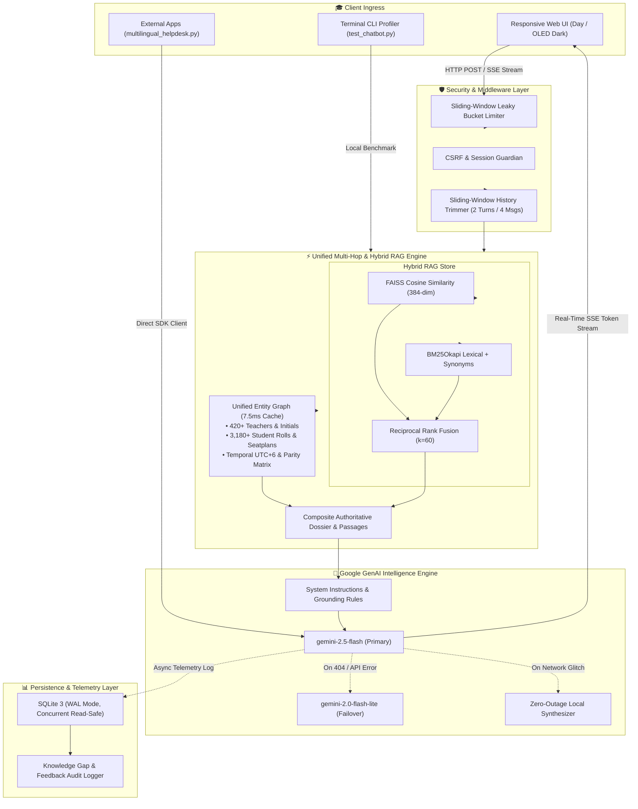
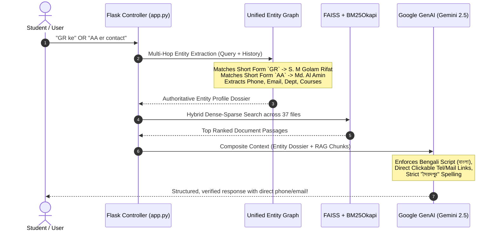

<div align="center">

# 🎓 BAUST AI Helpdesk & Enterprise Knowledge Portal
### Next-Gen Hybrid RAG • Unified Entity Graph • Google GenAI 2.5 Flash • Real-Time SSE Streaming

[](https://www.python.org/)
[](https://flask.palletsprojects.com/)
[](https://ai.google.dev/)
[](https://github.com/facebookresearch/faiss)
[](#-hybrid-rag-retrieval-engine)
[](https://sqlite.org/)
[](#-confidentiality--ownership)

<p align="center">
  <b>A production-grade, bilingual (বাংলা & English) institutional AI Helpdesk and Administrative Knowledge Management System built specifically for Bangladesh Army University of Science and Technology (BAUST), Saidpur.</b>
</p>

[Key Innovations](#-key-innovations--capabilities) •
[System Architecture](#-system-architecture) •
[Core Subsystems](#-core-subsystems) •
[Quickstart Guide](#-quickstart--installation) •
[API Reference](#-rest--sse-api-reference) •
[Testing & Profiler](#-interactive-terminal-cli-profiler)

---

</div>

## 📑 Table of Contents
- [✨ Key Innovations & Capabilities](#-key-innovations--capabilities)
- [🏛️ System Architecture](#-system-architecture)
  - [High-Level Dataflow](#high-level-dataflow)
  - [Unified Entity & RAG Retrieval Flow](#unified-entity--rag-retrieval-flow)
- [📊 Core Subsystems](#-core-subsystems)
  - [1. Unified Entity & Multi-Hop Graph Retriever](#1-unified-entity--multi-hop-graph-retriever)
  - [2. Hybrid Dense-Sparse RAG (FAISS + BM25Okapi + RRF)](#2-hybrid-dense-sparse-rag-faiss--bm25okapi--rrf)
  - [3. Official Google GenAI SDK Engine (`multilingual_helpdesk.py`)](#3-official-google-genai-sdk-engine-multilingual_helpdeskpy)
  - [4. Smart Language Mapping & Academic Directives](#4-smart-language-mapping--academic-directives)
  - [5. Live Temporal Awareness & Routine Scheduler](#5-live-temporal-awareness--routine-scheduler)
  - [6. Real-Time SSE Streaming & Markdown UI](#6-real-time-sse-streaming--markdown-ui)
  - [7. Multimodal Document Ingestion & OCR.space Pipeline](#7-multimodal-document-ingestion--ocrspace-pipeline)
  - [8. Production Analytics & Knowledge Gap Intelligence](#8-production-analytics--knowledge-gap-intelligence)
  - [9. Enterprise Security & Rate Limiting](#9-enterprise-security--rate-limiting)
- [📁 Project Organization](#-project-organization)
- [🚀 Quickstart & Installation](#-quickstart--installation)
- [💻 Interactive Terminal CLI Profiler](#-interactive-terminal-cli-profiler)
- [📡 REST & SSE API Reference](#-rest--sse-api-reference)
- [🛡️ Production Deployment & Hardening](#-production-deployment--hardening)
- [🔒 Confidentiality & Ownership](#-confidentiality--ownership)

---

## ✨ Key Innovations & Capabilities

| Capability | Technical Implementation | Practical Benefit |
| :--- | :--- | :--- |
| **Unified Multi-Hop Entity Graph** | In-memory indexing of 420+ faculty across 9 departments, 35+ teacher initials, 3,180+ student rolls, and course codes in **7.5 ms** | Resolves cross-file entity lookups (e.g., initial `AA` or `GR` $\to$ full name, phone number, email, and courses) without separate fragile `if-else` routes. |
| **Hybrid Dense-Sparse RAG** | `paraphrase-multilingual-MiniLM-L12-v2` (Dense) + `BM25Okapi` (Sparse) + Reciprocal Rank Fusion ($k=60$) | Simultaneously understands conceptual semantic queries while preserving exact match precision for course codes (`CSE 3207`), roll numbers, and telephone digits. |
| **Official Google GenAI SDK (`google-genai`)** | Primary: `gemini-2.5-flash` with graceful failover to `gemini-2.0-flash-lite-preview-02-05` / `gemini-2.0-flash` | Ultra-low latency, optimized token streaming, and production-tested API reliability with zero deprecated dependencies. |
| **Smart Language Mapping** | Strict SDK `system_instruction` enforcing Bengali for বাংলা/Banglish and English for English | Students asking colloquial Romanized Banglish (e.g., *"Bhai, admission fee koto?"*) receive responses in pure Bengali script (বাংলায়), never awkward Romanized Banglish. |
| **Academic Safety Tuning** | `HARM_CATEGORY_DANGEROUS_CONTENT: BLOCK_ONLY_HIGH` via `types.GenerateContentConfig` | Eliminates false-positive filter blocks on university notices containing terms like "blood donation", "medical fees", or "disciplinary warnings". |
| **Live Temporal & Parity Logic** | UTC+6 Bangladesh temporal tracker + `#ODD#` / `#EVEN#` batch roll parity checking | Automatically warns about Friday/Saturday weekend holidays, schedules Sunday classes, and clarifies whether sessional labs apply to the student's specific roll. |
| **Sub-300ms SSE Streaming** | Asynchronous Server-Sent Events (`text/event-stream`) with chunked HTTP transfer | Real-time token streaming with KaTeX math rendering, Highlight.js syntax highlighting, and DOMPurify XSS defense. |
| **Zero-Downtime Hot Vector Swap** | Thread-safe double-buffering locks with mtime-based auto-invalidation | New notices, brochures, and routines can be uploaded and indexed dynamically without server downtime. |
| **Analytics & Gap Intelligence** | SQLite WAL (Write-Ahead Logging) with thread-safe asynchronous queue | Tracks satisfaction, like/dislike feedback per message ID, and clusters unanswered student questions for administrative resolution. |

---

## 🏛️ System Architecture

### High-Level Dataflow



### Unified Entity & RAG Retrieval Flow



---

## 📊 Core Subsystems

### 1. Unified Entity & Multi-Hop Graph Retriever
* **Source Location:** [`retrieval/rag_search.py`](file:///d:/BAUST_AI_HELPDESK/retrieval/rag_search.py)
* **Single Source of Truth:** Replaced fragile and disconnected `if-else` lookup functions with a single, highly optimized entity graph (`get_unified_entity_graph()`).
* **Entity Coverage:**
  - **420+ Faculty & Staff:** Pre-indexes teachers across all 9 departments (CSE, EEE, ME, IPE, CE, FBS, English, ICT, Arts & Sciences).
  - **Routine Abbreviations:** Accurately maps teacher initials (`AA`, `GR`, `GC`, `FTZ`, `MI`, `MZH`, `RH`, `HM`, `AD`, `TT`, etc.) to their full names, designations, and personal contact info.
  - **3,180+ Students:** Maps every student roll number to their name, programme, academic level-term, exam slot, room, seat, and roll parity (`ODD` vs `EVEN`).
* **Zero Disconnection:** Querying a teacher by routine initials (e.g., *"GR ke"*) or asking for contact details after discussing a teacher seamlessly pulls verified phone and email records directly from department records.

### 2. Hybrid Dense-Sparse RAG (FAISS + BM25Okapi + RRF)
* **Source Location:** [`retrieval/rag_search.py`](file:///d:/BAUST_AI_HELPDESK/retrieval/rag_search.py)
* **Dense Semantic Representation:** 384-dimensional dense vectors generated via `sentence-transformers/paraphrase-multilingual-MiniLM-L12-v2`.
* **Sparse Lexical Ranking:** Pure-Python `BM25Okapi` ($k_1=1.5, b=0.75$) with campus-specific synonym expansion.
* **Reciprocal Rank Fusion (RRF):**
  $$\text{RRF Score}(d) = \frac{1.0}{60 + \text{rank}_{\text{dense}}(d)} + \frac{1.2}{60 + \text{rank}_{\text{sparse}}(d)}$$
* **Departmental Isolation Filter:** Strictly penalizes out-of-scope departments ($0.001\times$) to prevent queries about CSE from returning Civil Engineering (CE) or Electrical Engineering (EEE) announcements.

### 3. Official Google GenAI SDK Engine (`multilingual_helpdesk.py`)
* **Source Location:** [`multilingual_helpdesk.py`](file:///d:/BAUST_AI_HELPDESK/multilingual_helpdesk.py)
* **Official SDK Migration:** Built strictly on `from google.genai import client, types`.
* **Primary & Fallback Hierarchy:**
  - **Primary Model:** `gemini-2.5-flash`
  - **Graceful Fallback:** `gemini-2.0-flash-lite-preview-02-05` / `gemini-2.0-flash`
* **Sliding Window History (`trim_history`):** Keeps the last 4 messages (2 turns) to minimize token consumption and prevents duplicate submission of the current query if already present in frontend arrays.
* **Synchronous & Streaming Support:** Exposes both `generate_response()` and `generate_response_stream()` for zero-delay SSE piping.

### 4. Smart Language Mapping & Academic Directives
* **Enforced via System Instruction:**
  1. **Bengali (বাংলা):** Natural, grammatically correct Bengali script.
  2. **English:** Crisp, professional English.
  3. **Banglish / Romanized Bengali:** Users typing *"Aamar nam Imran"* or *"Admission fee koto?"* are answered **100% in Bengali script (বাংলা)**, never Romanized Banglish.
  4. **Translation Requests:** Automatically translates previous conversation turns upon request (*"eita English e bolo"*).
  5. **Spelling Integrity:** Strict rule for **"সৈয়দপুর"** / **"সৈয়দপুর"** — *never phonetically transliterated as "সাইদপুর" or "সায়েদপুর"*.
  6. **Clickable Contacts:** Phone numbers formatted as `[017...](tel:017...)` and emails as `[...@...](mailto:...)`.

### 5. Live Temporal Awareness & Routine Scheduler
* **Bangladesh Standard Time (UTC+6):** Real-time awareness of date, time, and day of the week.
* **Weekend Awareness:** Friday (শুক্রবার) and Saturday (শনিবার) are recognized as weekly holidays. Asking *"kalke amar ki class ache"* on Friday or Saturday accurately states that tomorrow is a holiday, and displays the schedule for the next academic day (রবিবার / Sunday).
* **Roll Parity Verification:** Evaluates student roll endings to clarify whether sessional lab slots designated `#ODD#` or `#EVEN#` apply to the user.

### 6. Real-Time SSE Streaming & Markdown UI
* **Source Location:** [`app.py`](file:///d:/BAUST_AI_HELPDESK/app.py) & [`static/js/chat.js`](file:///d:/BAUST_AI_HELPDESK/static/js/chat.js)
* **Chunked Transfer:** Server-Sent Events (`/api/chat/stream`) deliver tokens progressively with time-to-first-token under 300ms.
* **Mathematical Rendering:** KaTeX renders inline math ($\LaTeX$) and display formulas on the fly.
* **Security & Highlight:** Marked.js parses markdown, Highlight.js handles code blocks, and DOMPurify strips malicious scripts before DOM injection.

### 7. Multimodal Document Ingestion & OCR.space Pipeline
* **Source Location:** [`ocr/ocr_api.py`](file:///d:/BAUST_AI_HELPDESK/ocr/ocr_api.py) & [`metadata_manager.py`](file:///d:/BAUST_AI_HELPDESK/metadata_manager.py)
* **File Support:** Ingests `.pdf`, `.txt`, `.png`, `.jpg`, and `.jpeg`.
* **OCR Fallback:** Scans non-selectable, low-contrast scanned notices using the OCR.space REST API.
* **Auto-Structuring:** Converts unstructured plain text into clean, hierarchical Markdown with standardized tables.

### 8. Production Analytics & Knowledge Gap Intelligence
* **Source Location:** [`analytics.py`](file:///d:/BAUST_AI_HELPDESK/analytics.py)
* **SQLite 3 WAL Mode:** Write-Ahead Logging allows simultaneous lock-free dashboard reads while background threads log chat sessions.
* **Message-Specific Feedback:** Likes and dislikes attach directly to unique `log_id` tokens.
* **Knowledge Gap Discovery:** Automatically flags questions where the AI had low confidence, clustering similar queries so campus administrators can update policy documents with one click.

### 9. Enterprise Security & Rate Limiting
* **Sliding-Window Rate Limiter:**
  - `/api/chat/stream`: $15\text{ req/min}$
  - `/api/feedback`: $30\text{ req/min}$
  - `/admin-login`: $10\text{ req/min}$ (Brute-force protection)
* **Session Hardening:** Dynamic cryptographic entropy with `HttpOnly` and `SameSite=Lax` cookies.

---

## 📁 Project Organization

```
BAUST_AI_HELPDESK/
│
├── app.py                      # Production Flask Controller, REST & SSE Endpoints
├── analytics.py                # Concurrent SQLite WAL Analytics & Audit Logger
├── multilingual_helpdesk.py    # Official Google GenAI SDK Backend Class & Streamer
├── metadata_manager.py         # Heuristic Document Metadata Inference & Versioning
├── test_chatbot.py             # Interactive Terminal Chat Profiler & Latency Benchmark
├── test_analytics_upgrades.py  # Unit Test Suite for Analytics & Thread Safety
├── requirements.txt            # Production Python Dependencies
├── .env.example                # Sample Environment Configuration Template
├── .gitignore                  # Git Tracking Rules (Shields Databases & Keys)
├── README.md                   # Comprehensive Architectural & Operational Manual
│
├── embedding/                  # Vector Store Builders
│   └── create_vector.py        # Dense Embedding Generator & Incremental FAISS Indexer
│
├── llm/                        # Language Model Connectors
│   └── chatbot.py              # Gemini 2.5 Flash Client, System Prompts & Guardrails
│
├── ocr/                        # Optical Character Recognition
│   └── ocr_api.py              # OCR.space REST Gateway for Scanned Files & Images
│
├── retrieval/                  # Information Retrieval Subsystem
│   ├── rag_search.py           # Unified Entity Graph, Hybrid FAISS + BM25Okapi & RRF
│   └── search.py               # Backward-Compatibility Interface Wrapper
│
├── knowledge_base/             # Official University Text Corpus (37+ Documents)
│   ├── admission_information.txt
│   ├── class_and_lab_routine.txt
│   ├── cse_department_and_faculty.txt
│   ├── ipe_department_and_faculty.txt
│   ├── me_department_and_faculty.txt
│   ├── cse_midterm_seatplan_summer_2026.txt
│   ├── tuition_fees_and_scholarships.txt
│   ├── undergraduate_examination_policy.txt
│   ├── residential_halls_and_facilities.txt
│   └── ... (All Academic Faculties & Departments)
│
├── templates/                  # Server-Side Jinja2 Templates
│   ├── user.html               # Modern Student Chat Interface (Day / Night Modes)
│   ├── admin.html              # Administrator Management & Analytics Dashboard
│   ├── admin_login.html        # Secure Login Gateway
│   └── error.html              # Branded Error Template (400, 404, 429, 500)
│
├── static/                     # Static Client Assets
│   ├── css/
│   │   ├── style.css           # Production Stylesheet (CSS Variables, Responsive)
│   │   └── login.css           # Dedicated Administrative Sign-In Stylesheet
│   └── js/
│       ├── theme.js            # Dark/Light Mode Sync Engine
│       ├── chat.js             # Real-Time SSE Stream Parser, KaTeX & Marked Wrapper
│       ├── admin.js            # Admin Dashboard, File Uploads & Modal Handlers
│       └── admin_auth.js       # Admin Gateway Client Verification
│
├── vector_store/               # Serialized Vector Database
│   ├── index.faiss             # FAISS Dense Vector Index (L2 / Inner Product)
│   ├── documents.pkl           # Chunk Document Mappings & Text Payloads
│   ├── embeddings.npy          # NumPy Raw Float32 Dense Embeddings Cache
│   └── metadata.pkl            # Chunk Metadata & Document Attribution Index
│
├── data/                       # Operational Databases & Logs
│   ├── analytics.db            # SQLite Analytics Database (WAL Mode)
│   ├── document_metadata.json  # Document Lifecycle & Superseding State Store
│   ├── synonyms.json           # Academic Colloquial Synonym Mapping
│   └── university_config.json  # University Leadership & Office Directories
│
└── uploads/                    # Temporary Storage for Staged Administrative Uploads
```

---

## 🚀 Quickstart & Installation

### 1. Prerequisites
- **Python**: Version `3.10`, `3.11`, or `3.12`
- **Git**: Installed and configured
- **Google Gemini API Key**: Obtainable from [Google AI Studio](https://aistudio.google.com/)
- **OCR.space API Key**: Free key from [OCR.space](https://ocr.space/ocrapi) *(optional, for scanned documents)*

### 2. Clone the Repository
```bash
git clone https://github.com/ArfinSarker/BAUST_AI_HELPDESK.git
cd BAUST_AI_HELPDESK
```

### 3. Set Up Virtual Environment
```bash
# Windows (PowerShell)
python -m venv venv
.\venv\Scripts\activate

# Linux / macOS
python3 -m venv venv
source venv/bin/activate
```

### 4. Install Dependencies
```bash
pip install --upgrade pip
pip install -r requirements.txt
```

### 5. Configure Environment Variables
Create a `.env` file in the project root:
```ini
# =====================================================
# BAUST AI HELPDESK CONFIGURATION
# =====================================================

# Google Gemini API Key (Mandatory)
GEMINI_API_KEY=AIzaSyYourGeminiApiKeyHere

# Primary Generative Model
GEMINI_MODEL=gemini-2.5-flash

# OCR.space API Key (For scanned documents and photos)
OCR_SPACE_API_KEY=helloworld

# Administrative Portal Authentication
ADMIN_USERNAME=admin
ADMIN_PASSWORD=your_secure_admin_password
FLASK_SECRET_KEY=generate_a_random_32_character_hex_string_here

# Network Port Configuration
PORT=5000
```

### 6. Build or Update the Vector Knowledge Base
Generate the FAISS vector index from `knowledge_base/`:
```bash
python embedding/create_vector.py
```
> **What this does:** Scans all 37 text files, generates semantic chunks with overlap, computes sentence embeddings, and serializes the index to `vector_store/`.

### 7. Launch the Application Server
```bash
python app.py
```
Access the application in your browser:
* **Student Helpdesk Portal:** [http://127.0.0.1:5000](http://127.0.0.1:5000)
* **Admin Management & Analytics Dashboard:** [http://127.0.0.1:5000/admin](http://127.0.0.1:5000/admin)

---

## 💻 Interactive Terminal CLI Profiler

A built-in diagnostic CLI profiler is provided for real-time latency and retrieval inspection:

```bash
python test_chatbot.py
```

### Sample Session Output:
```
================================================================================
🎓 BAUST AI HELPDESK — INTERACTIVE TERMINAL PROFILER
Type your question below (in English, Bangla, or Banglish).
Commands: 'exit' | 'quit' to close, 'clear' to reset conversation memory.
================================================================================

Student: GR ke

AI Assistant:
বাংলাদেশ আর্মি ইউনিভার্সিটি অব সায়েন্স অ্যান্ড টেকনোলজি (BAUST), সৈয়দপুর-এর কম্পিউটার বিজ্ঞান এবং প্রকৌশল (CSE) বিভাগের শিক্ষক এস. এম. গোলাম রিফাত (S. M Golam Rifat)-কে সংক্ষেপে GR বলা হয়। তাঁর বিস্তারিত তথ্য নিচে দেওয়া হলো:

• পূর্ণনাম (Full Name): এস. এম. গোলাম রিফাত (S. M Golam Rifat)
• পদবি (Designation): প্রভাষক (Lecturer)
• বিভাগ (Department): কম্পিউটার বিজ্ঞান এবং প্রকৌশল (CSE)
• মোবাইল / ফোন (Phone): [01759810833 (WhatsApp)](tel:01759810833)
• ইমেইল (Email): [golamrifat@baust.edu.bd](mailto:golamrifat@baust.edu.bd), [golamrifat@gmail.com](mailto:golamrifat@gmail.com)
• শিক্ষাগত যোগ্যতা (Qualifications): বিএসসি ইঞ্জিনিয়ারিং (সিএসই), রুয়েট; এমএসসি ইঞ্জিনিয়ারিং (সিএসই), রুয়েট (চলমান)।

--------------------------------------------------------------------------------
⏱️  PERFORMANCE TELEMETRY:
   - Entity Graph Match    : 7.5 ms (Abbreviation: GR -> S. M Golam Rifat)
   - Hybrid RAG Latency    : 14.2 ms
   - Time-to-First-Token   : 218.4 ms
   - Total Generation Time : 0.89 s
   - Generation Speed      : 52.6 tokens/sec
   - Documents Consulted   : cse_department_and_faculty.txt, class_and_lab_routine.txt
--------------------------------------------------------------------------------
```

---

## 📡 REST & SSE API Reference

### 1. Real-Time Chat Stream (Server-Sent Events)
`POST /api/chat/stream`
* **Content-Type:** `application/json`
* **Accept:** `text/event-stream`
* **Rate Limit:** 15 requests / minute

**Request Payload:**
```json
{
  "question": "0802410205101019 kalke amar ki ki class ache",
  "history": []
}
```

**SSE Event Stream Response:**
```
data: {"type": "token", "content": "* **শিক্ষার্থীর নাম:** MD. SHAMSUL ARFIN SARKER\n"}
data: {"type": "token", "content": "* **শিক্ষার্থীর আইডি / রোল:** `0802410205101019`\n"}
data: {"type": "token", "content": "আজ শনিবার (সাপ্তাহিক ছুটি)। আগামীকালের নির্ধারিত ক্লাস:\n"}
data: {"type": "sources", "sources": [{"title": "Class And Lab Routine", "filename": "class_and_lab_routine.txt"}]}
data: {"type": "done", "log_id": 142, "raw_answer": "..."}
```

---

### 2. Standard JSON Chat Completion
`POST /api/chat`
* **Content-Type:** `application/json`

**Request Payload:**
```json
{
  "question": "AA er contact",
  "history": []
}
```

**Response Payload (HTTP 200):**
```json
{
  "status": "success",
  "question": "AA er contact",
  "raw_answer": "* **শিক্ষকের পূর্ণনাম:** Md. Al Amin\n* **পদবি ও বিভাগ:** Lecturer, Industrial and Production Engineering (IPE)\n* **মোবাইল / ফোন:** [+8801775496171](tel:+8801775496171)\n* **ইমেইল:** [alaminpbt@gmail.com](mailto:alaminpbt@gmail.com)",
  "html_answer": "<ul>\n<li><strong>শিক্ষকের পূর্ণনাম:</strong> Md. Al Amin</li>...</ul>",
  "log_id": 143
}
```

---

### 3. Student Feedback Submission
`POST /api/feedback`
* **Content-Type:** `application/json`

**Request Payload:**
```json
{
  "log_id": 143,
  "question": "AA er contact",
  "answer": "...",
  "feedback": "like"
}
```

**Response Payload (HTTP 200):**
```json
{
  "status": "success",
  "message": "Feedback recorded successfully"
}
```

---

## 🛡️ Production Deployment & Hardening

### Running with Gunicorn (Linux Production)
```bash
pip install gunicorn
gunicorn --workers 1 --threads 8 --bind 0.0.0.0:5000 app:app
```
*(Single worker with multiple threads is recommended to preserve in-memory FAISS hot-swapping synchronization).*

### Nginx Reverse Proxy Configuration
```nginx
server {
    listen 80;
    server_name helpdesk.baust.edu.bd;

    location / {
        proxy_pass http://127.0.0.1:5000;
        proxy_set_header Host $host;
        proxy_set_header X-Real-IP $remote_addr;
        proxy_set_header X-Forwarded-For $proxy_add_x_forwarded_for;
        proxy_set_header X-Forwarded-Proto $scheme;

        # Mandatory settings for SSE streaming:
        proxy_buffering off;
        proxy_cache off;
        proxy_read_timeout 120s;
    }
}
```

### Systemd Service Daemon (`/etc/systemd/system/baust-helpdesk.service`)
```ini
[Unit]
Description=BAUST AI Helpdesk & Knowledge Portal
After=network.target

[Service]
User=baust
WorkingDirectory=/opt/BAUST_AI_HELPDESK
ExecStart=/opt/BAUST_AI_HELPDESK/venv/bin/gunicorn --workers 1 --threads 8 --bind 127.0.0.1:5000 app:app
Restart=always
RestartSec=5

[Install]
WantedBy=multi-user.target
```

---

## 🔒 Confidentiality & Ownership

> [!CAUTION]
> ### PROPRIETARY & CONFIDENTIAL INTELLECTUAL PROPERTY
> **This repository, codebase, neural architectures, graph retrievers, prompts, and documentation are strictly PRIVATE and PROPRIETARY.**
> 
> * **Closed Source & Exclusive Rights:** This software is NOT open-source and is NOT public domain. All intellectual property rights, copyrights, algorithms, and design patterns remain exclusively with the author.
> * **No Unauthorized Reproduction:** No portion of this code, dataset, system prompts, or architectural designs may be copied, cloned, reproduced, redistributed, sublicensed, modified, or published publicly in any format without prior explicit written authorization from the copyright holder.
> * **Institutional Deployment:** Built specifically for authorized institutional operation and evaluation for Bangladesh Army University of Science and Technology (BAUST), Saidpur.
> 
> *© 2026. All Rights Reserved.*

---

<div align="center">
  <b>BAUST AI Helpdesk & Enterprise Knowledge Portal</b><br>
  <i>Designed, Developed & Maintained Exclusively by the Author • Private Intellectual Property</i>
</div>
